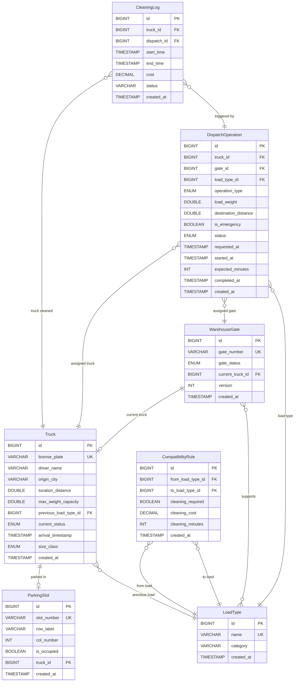

# Walmart Warehouse Truck Management System

> A college DBMS project built with **Java 17 + Spring Boot 3 + MySQL 8 + Thymeleaf + Bootstrap 5**

## 📋 Project Overview

This system manages the flow of trucks through a warehouse: **arrival → parking → dispatch → cleaning (if needed) → loading/unloading at gates → departure**. It demonstrates relational database design (3NF), complex SQL queries (JOINs, UNIONs, GROUP BY, subqueries), and a full-stack web application.

## ✨ Features

- **Truck Arrival & Parking** – Register trucks and auto-assign parking slots (4×10 grid)
- **Dispatch Operations** – Create, assign, track, and complete loading/unloading requests
- **Priority Algorithm** – Emergency requests get nearest truck; normal requests get largest truck (FIFO)
- **Gate Management** – 6 gates with load-type restrictions and optimistic locking
- **Cleaning System** – Automatic cleaning detection based on load compatibility matrix
- **Real-time Dashboard** – Auto-refreshing cards, gate tiles, and progress bars (5s polling)
- **Reports** – Aggregate queries with GROUP BY, HAVING, UNION, and subqueries
- **Simulation** – Speed-factor property for fast demo (60 = 1 second = 1 minute)

## 🛠 Tech Stack

| Layer      | Technology                                      |
|------------|------------------------------------------------|
| Backend    | Java 17, Spring Boot 3.2, Spring Data JPA      |
| Database   | MySQL 8 (Hibernate DDL auto-update)             |
| Templates  | Thymeleaf + Bootstrap 5 CDN                     |
| Frontend   | Vanilla JavaScript (Fetch API, setInterval)     |
| Build      | Maven                                           |
| Other      | Lombok, Jakarta Validation                      |

## 📊 ER Diagram



## 🗄 Database Tables (3NF Explanation)

The database is in **Third Normal Form (3NF)**:
- **1NF**: All columns have atomic values; no repeating groups
- **2NF**: Every non-key column depends on the entire primary key (all PKs are single-column `id`)
- **3NF**: No transitive dependencies — e.g., `size_class` is computed from `max_weight_capacity` but stored for query performance

| Table | Purpose |
|-------|---------|
| `load_type` | Master list of 6 cargo types (COAL, IRON, FOOD, etc.) with categories |
| `truck` | Every truck that enters the warehouse, with status tracking |
| `parking_slot` | 40 slots in a 4×10 grid; FK to truck when occupied |
| `warehouse_gate` | 6 loading/unloading gates with optimistic locking |
| `gate_load_type` | Many-to-many: which gates handle which load types |
| `compatibility_rule` | Cleaning rules when switching between load types |
| `cleaning_log` | Records of every truck cleaning event |
| `dispatch_operation` | The main workflow table tracking dispatch lifecycle |

## 📁 Folder Structure

```
src/main/java/com/walmart/truckmgt/
├── TruckMgmtApplication.java    # Spring Boot entry point
├── config/
│   ├── CorsConfig.java          # CORS for API access
│   └── DataSeeder.java          # Seeds DB on first run
├── model/
│   ├── entity/                  # JPA entities + enums (Truck, Gate, etc.)
│   └── dto/                     # Request/response DTOs + projections
├── repository/                  # Spring Data JPA repos with custom queries
├── service/                     # Business logic (Dispatch, Priority, Cleaning, etc.)
├── controller/                  # @Controller for Thymeleaf pages
├── rest/                        # @RestController for JSON APIs
└── exception/                   # Custom exceptions + global handler
```

## 🚀 Run Instructions

### Prerequisites
1. **JDK 17** – [Download](https://adoptium.net/)
2. **MySQL 8** – [Download](https://dev.mysql.com/downloads/)
3. **Maven 3.8+** – [Download](https://maven.apache.org/)

### Steps
1. **Clone the project** and navigate to `walmart-truck-mgmt/`
2. **Set your MySQL password** in `src/main/resources/application.yml`:
   ```yaml
   spring.datasource.password: YOUR_PASSWORD_HERE
   ```
3. **Build and run**:
   ```bash
   mvn clean compile
   mvn spring-boot:run
   ```
4. **Open** [http://localhost:8080](http://localhost:8080) in your browser
5. The database `walmart_truck_db` is created automatically, and seed data is loaded on first run

### For Fast Demo
Set `app.simulation.speed-factor: 60` in `application.yml` — each real second counts as one simulated minute.

## 📡 API Endpoints

| Method | Endpoint | Description |
|--------|----------|-------------|
| GET | `/api/trucks` | List all trucks |
| GET | `/api/trucks/{id}` | Get truck by ID |
| POST | `/api/trucks/arrive` | Register truck arrival |
| PUT | `/api/trucks/{id}` | Update truck |
| DELETE | `/api/trucks/{id}` | Delete truck |
| GET | `/api/trucks/status/{status}` | Filter by status |
| GET | `/api/trucks/ledger` | UNION: parking + cleaning |
| GET | `/api/trucks/above-average-capacity` | Subquery: above avg |
| GET | `/api/parking/slots` | Parking grid data |
| GET | `/api/parking/stats` | Parking stats |
| POST | `/api/parking/release/{truckId}` | Release truck |
| GET | `/api/gates` | List all gates |
| GET | `/api/gates/overview` | Gate overview (JOIN) |
| GET | `/api/gates/{id}` | Gate by ID |
| POST | `/api/gates` | Create gate |
| PUT | `/api/gates/{id}/load-types` | Update gate load types |
| POST | `/api/dispatch/request` | Create dispatch request |
| GET | `/api/dispatch` | All dispatches |
| GET | `/api/dispatch/pending` | Pending dispatches |
| GET | `/api/dispatch/active` | Active dispatches |
| POST | `/api/dispatch/{id}/assign` | Assign single |
| POST | `/api/dispatch/auto-assign` | Auto-assign all pending |
| POST | `/api/dispatch/{id}/complete` | Complete dispatch |
| POST | `/api/dispatch/{id}/cancel` | Cancel dispatch |
| GET | `/api/dispatch/history` | Dispatch history |
| GET | `/api/cleaning/active` | Active cleaning |
| GET | `/api/cleaning/logs` | Cleaning history |
| POST | `/api/cleaning/{id}/complete` | Complete cleaning |
| GET | `/api/cleaning/cost-by-truck?min=` | Cost aggregate |
| GET | `/api/reports/weight-by-load-type` | Weight per load type |
| GET | `/api/reports/gate-performance` | Gate stats |
| GET | `/api/reports/size-class-counts` | Size class counts |
| GET | `/api/reports/daily-summary` | Daily totals |
| GET | `/api/reports/active-trucks` | UNION: active trucks |
| GET | `/api/load-types` | All load types |
| GET | `/api/compatibility` | All rules |
| GET | `/api/compatibility/check?from=&to=` | Check pair |
| GET | `/api/dashboard/summary` | Dashboard data |

## 📖 Business Rules Explained

### Priority Algorithm (Truck Selection)
**Normal request**: Pick the LARGEST truck that fits, then FIFO by arrival time.
> Example: 15t load needed. Trucks: 30t (arrived 2h ago), 20t (arrived 1h ago), 8t. The 30t truck is selected (LARGE > MEDIUM, and it arrived first among LARGE trucks).

**Emergency request**: Pick the NEAREST truck that fits, then FIFO.
> Example: Emergency 10t load. Trucks at 50km, 120km, 300km (all ≥10t). The 50km truck is selected.

### Cleaning Rules
When a truck switches load types, it may need cleaning:
> Example: Truck previously carried COAL, now needs to carry FOOD → Cleaning required (₹5000, 60 min). Truck previously carried FOOD, now COAL → No cleaning needed.

### Dispatch Lifecycle
```
PENDING → ASSIGNED → [IN_CLEANING →] IN_PROGRESS → COMPLETED
                                                   → CANCELLED
```

## 🔍 Complex Queries Explained

1. **Gate Overview (JOIN)** – Joins gates with trucks, dispatch operations, and load types to show a complete picture of each gate
2. **Dispatch History (JOIN)** – Fetches full dispatch details with truck, gate, and load type info
3. **Combined Ledger (UNION)** – Merges trucks in parking and trucks in cleaning into one list
4. **Active Trucks (UNION)** – Merges trucks at gates and trucks in cleaning
5. **Cleaning Cost per Truck (GROUP BY + HAVING)** – Total cleaning cost grouped by truck, filtered by minimum threshold
6. **Weight per Load Type (GROUP BY)** – Completed dispatches grouped by load type
7. **Gate Performance (GROUP BY)** – Dispatch count and average duration per gate
8. **Daily Summary (GROUP BY)** – Dispatches per day with total weight
9. **Above Average Capacity (Subquery)** – Trucks whose capacity exceeds the fleet average

## 🎯 Demo Script for Examiner

1. Open http://localhost:8080 — see dashboard with 12 parked trucks, 3 pending dispatches
2. Go to **Parking** — see the 4×10 grid, 12 occupied (red), 28 free (green)
3. Register a new truck: plate=`TEST-01`, driver=`Demo`, city=`Mumbai`, distance=`100`, capacity=`20t`
4. Go to **Dispatch** — create a new request: FOOD, 15t, LOADING, emergency ✓
5. Click **Assign** on the pending request — truck is selected by priority, cleaning check runs
6. Go to **Gates** — see the truck at a gate with a progress bar
7. Go to **Cleaning** — if cleaning was needed, click Complete
8. Watch the progress bar fill up (or set speed-factor=60 for instant demo)
9. Go to **Reports** — show aggregate tables
10. Go to **Rules** — show the compatibility matrix

## 🔮 Future Improvements

- User authentication and role-based access (admin, operator, viewer)
- WebSocket for true real-time updates (instead of polling)
- Route optimization for truck dispatch
- Barcode/QR scanning for truck check-in
- Email/SMS notifications for dispatch events
- Docker containerization for easy deployment
- Unit and integration tests
